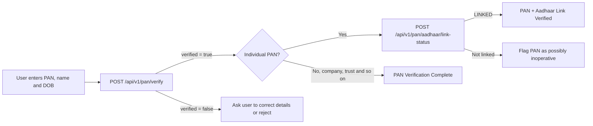
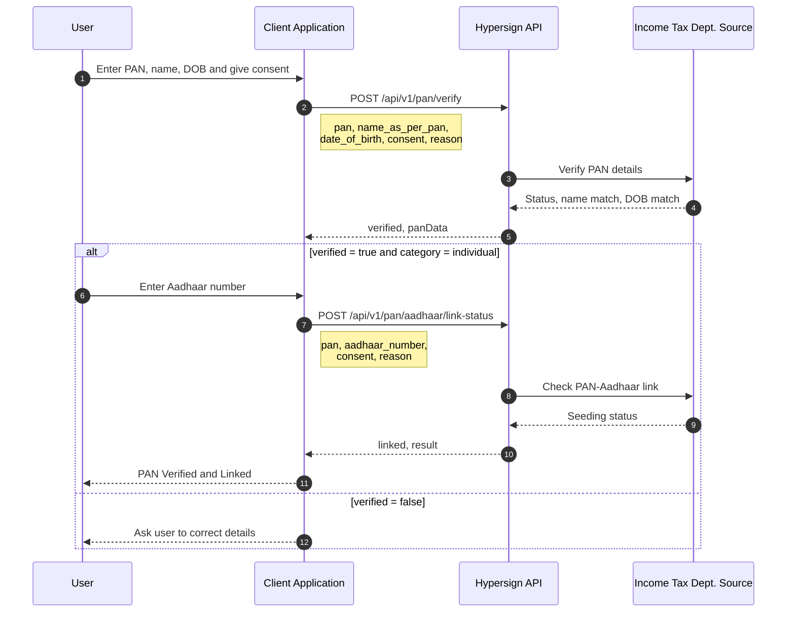
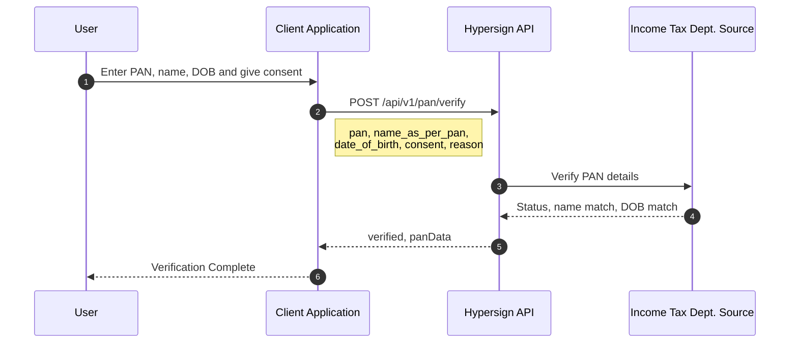

# How to Integrate PAN Verification APIs?

Hypersign's **Compliant PAN Verification APIs** let organizations confirm an individual's or entity's Permanent Account Number (PAN) against the Income Tax Department source, and check whether an individual's PAN is linked to their Aadhaar.

The platform provides two verification capabilities that can be used independently or combined with each other and with Hypersign's Aadhaar Verification APIs:

* **PAN Verification**: Confirm that a PAN exists and is valid, and check that the name and date of birth (or date of incorporation) supplied by the user match the PAN record.
* **PAN–Aadhaar Link Status**: Check whether an individual's PAN is linked to a given Aadhaar number. A PAN that is not linked to Aadhaar may be treated as inoperative under Income Tax rules.

Both APIs are **match-based**. You send the details the user gave you, and Hypersign tells you whether they match the source. The APIs never return the PAN holder's name, date of birth or Aadhaar number, so your application handles only the data it already collected.

Whether you are building a lending app, a brokerage or investment onboarding flow, a payroll or vendor onboarding system, or a general customer KYC workflow, Hypersign lets you add PAN verification with **explicit consent**, **purpose capture** and **data minimization** built in.

***

### Supported Verification Flows



### Base URL

```
https://api.cavach.hypersign.id
```

### Authentication

All PAN Verification APIs require an **Access Token** for authentication.

Authentication is a two-step process:

1. Generate a **KYC API Secret** from the Hypersign Dashboard.
2. Exchange the API Secret for a short-lived **Access Token**.

The generated Access Token must be sent in the `x-kyc-access-token` header of every API request. See the Detailed Steps To Generate Access Token section below.

### Consent and Reason

Both PAN APIs require two compliance fields on every request:

| Field     | Rule                                 | Why it is needed                                                                                    |
| --------- | ------------------------------------ | --------------------------------------------------------------------------------------------------- |
| `consent` | Must be `"Y"`                        | Confirms that the PAN holder explicitly agreed to the check. Capture this consent in your UI first. |
| `reason`  | String of **at least 20 characters** | The purpose of the check, for example `"Verifying PAN for customer onboarding"`. Kept for audit.    |

> **Important:** Only send `consent: "Y"` after the user has actually agreed, for example by ticking a consent checkbox that explains why you are checking their PAN. Store that consent record on your side.

### Verify PAN

Checks a PAN against the Income Tax Department source and reports whether the PAN is valid and whether the name and date of birth you supplied match the PAN record.

> **When to use:**\
> Use this API during onboarding to confirm that the PAN the user entered is real, active and belongs to the person (or entity) they claim to be.

#### POST /api/v1/pan/verify

**Request Body**

```json
{
  "pan": "XXXPX1234A",
  "name_as_per_pan": "John Ronald Doe",
  "date_of_birth": "11/11/2001",
  "consent": "Y",
  "reason": "Verifying PAN for customer onboarding"
}
```

| Field             | Type   | Required | Description                                                                                                                                                   |
| ----------------- | ------ | -------- | ------------------------------------------------------------------------------------------------------------------------------------------------------------- |
| `pan`             | string | Yes      | 10-character PAN in **uppercase**: 5 letters, 4 digits, 1 letter (for example `ABCPE1234F`). **For development/test mode, use `XXXPX1234A`** (see Test Data). |
| `name_as_per_pan` | string | Yes      | Full name exactly as printed on the PAN card (at least 2 characters). For a company or trust, use the registered entity name.                                 |
| `date_of_birth`   | string | Yes      | Date of birth for individuals, or date of incorporation for entities, in `DD/MM/YYYY` format. Must be a real calendar date that is not in the future.         |
| `consent`         | string | Yes      | Explicit consent of the PAN holder. Must be `"Y"`.                                                                                                            |
| `reason`          | string | Yes      | Purpose of the verification, at least 20 characters.                                                                                                          |

> **Tip:** Convert the PAN to uppercase on your side before sending it. Lowercase PANs are rejected with a `400`.

**Successful Response**

```json
{
  "success": true,
  "message": "success",
  "data": {
    "verified": true,
    "panData": {
      "category": "individual",
      "status": "valid",
      "remarks": null,
      "nameMatch": true,
      "dobMatch": true,
      "aadhaarSeedingStatus": "y"
    }
  }
}
```

| Field                               | Type           | Description                                                                                                                              |
| ----------------------------------- | -------------- | ---------------------------------------------------------------------------------------------------------------------------------------- |
| `success`                           | boolean        | Indicates whether the request was processed successfully.                                                                                |
| `message`                           | string         | Overall status of the API response.                                                                                                      |
| `data.verified`                     | boolean        | `true` **only** when the PAN status is `valid` **and** both the name and date of birth match. Use this as your primary pass/fail signal. |
| `data.panData.category`             | string         | PAN holder category: `individual`, `company`, `trust`, `association_of_persons`, `body_of_individuals`, and so on.                       |
| `data.panData.status`               | string         | PAN status as reported by the source, in lowercase (for example `valid`).                                                                |
| `data.panData.remarks`              | string \| null | Remarks from the source, for example `"Holder is Deceased"`, `"Liquidated"` or `"Merger"`. `null` when there are none.                   |
| `data.panData.nameMatch`            | boolean        | Whether `name_as_per_pan` matches the PAN record.                                                                                        |
| `data.panData.dobMatch`             | boolean        | Whether `date_of_birth` matches the PAN record.                                                                                          |
| `data.panData.aadhaarSeedingStatus` | string         | Whether the PAN is seeded (linked) with an Aadhaar: `y` (yes), `n` (no) or `na` (not applicable, for example non-individual PANs).       |

> **Always check `remarks`.** A PAN can come back with `verified: true` and still carry a remark such as `"Holder is Deceased"`. Decide in your own business rules how to treat each remark, for example by sending such cases to manual review.

A **mismatch is not an error.** When the name or date of birth does not match, the API still returns `200` with `verified: false`, and `nameMatch` / `dobMatch` tell you which field failed. You can let the user correct the field and try again.

**Error Response**

```json
{
  "success": false,
  "message": "Bad Request",
  "error": {
    "code": 400,
    "details": [
      "pan must be 5 uppercase letters, 4 digits and 1 uppercase letter"
    ]
  }
}
```

`error.details` holds one or more readable messages that you can show to the end user.

**Status Codes**

| Status | Message in error.details                                                                                                                                                                                     | Meaning and what to do                                                                                                    |
| ------ | ------------------------------------------------------------------------------------------------------------------------------------------------------------------------------------------------------------ | ------------------------------------------------------------------------------------------------------------------------- |
| 200    | (no error)                                                                                                                                                                                                   | The check ran. Read `data.verified`, then `data.panData` for which fields matched and any remarks.                        |
| 400    | pan must be 5 uppercase letters, 4 digits and 1 uppercase letter · date\_of\_birth must be a valid past date in DD/MM/YYYY format · consent must be Y · reason must be longer than or equal to 20 characters | The request body is incomplete or in the wrong format. Fix the request.                                                   |
| 400    | Invalid PAN number                                                                                                                                                                                           | The source rejected the PAN format. Ask the user to check the PAN. Retrying the same PAN will not help.                   |
| 400    | Consent is required · Invalid PAN details                                                                                                                                                                    | The source rejected the request details. Check the PAN and consent, then fix the request.                                 |
| 400    | For test mode use one of the Sandbox test PANs: …                                                                                                                                                            | Your app is in development/test mode and the PAN is not one of the test PANs. Use a value from Test Data.                 |
| 401    | Invalid or expired token · Please pass the authorization token in the header                                                                                                                                 | Your access token is missing, invalid or expired. Get a new token and retry.                                              |
| 402    | Insufficient credits                                                                                                                                                                                         | Your account has run out of credits. Top up from the dashboard.                                                           |
| 429    | PAN verification request limit exceeded. Please try again later                                                                                                                                              | Too many requests. Back off and retry later.                                                                              |
| 502    | PAN verification service is temporarily unavailable                                                                                                                                                          | The verification network did not give a usable answer. Wait about 60 seconds and retry once. Don't retry in a tight loop. |
| 503    | PAN verification source is temporarily unavailable. Please try again later                                                                                                                                   | The Income Tax Department source is down. Retry later, or let the user continue and verify the PAN in the background.     |
| 500    | Internal server error                                                                                                                                                                                        | An unexpected error on our side. Retry later, and contact support if it continues.                                        |

### Check PAN–Aadhaar Link Status

Checks whether an **individual** PAN is linked to the given Aadhaar number.

> **When to use:**\
> Use this API after **Verify PAN** for individual PANs when your process needs an operative PAN, for example for tax deduction, investments or lending. It is only available for individual PANs. Company, trust and other entity PANs are not linked to Aadhaar.

#### POST /api/v1/pan/aadhaar/link-status

**Request Body**

```json
{
  "pan": "XXXPX1234A",
  "aadhaar_number": "123456789012",
  "consent": "Y",
  "reason": "Verifying PAN-Aadhaar link for onboarding"
}
```

| Field            | Type   | Required | Description                                                                                             |
| ---------------- | ------ | -------- | ------------------------------------------------------------------------------------------------------- |
| `pan`            | string | Yes      | Individual PAN in **uppercase**. **For development/test mode, use `XXXPX1234A`** (see Test Data).       |
| `aadhaar_number` | string | Yes      | 12-digit Aadhaar number, digits only with no spaces. **For development/test mode, use `123456789012`.** |
| `consent`        | string | Yes      | Explicit consent of the PAN holder. Must be `"Y"`.                                                      |
| `reason`         | string | Yes      | Purpose of the check, at least 20 characters.                                                           |

**Successful Response**

```json
{
  "success": true,
  "message": "success",
  "data": {
    "linked": true,
    "result": "LINKED",
    "aadhaarSeedingStatus": "y",
    "message": "PAN is linked with Aadhaar"
  }
}
```

| Field                       | Type    | Description                                                          |
| --------------------------- | ------- | -------------------------------------------------------------------- |
| `success`                   | boolean | Indicates whether the request was processed successfully.            |
| `message`                   | string  | Overall status of the API response.                                  |
| `data.linked`               | boolean | `true` only when the PAN is linked to the given Aadhaar number.      |
| `data.result`               | string  | The detailed outcome. See the table below.                           |
| `data.aadhaarSeedingStatus` | string  | Seeding status reported by the source: `y`, `n` or `na`.             |
| `data.message`              | string  | A readable description of the outcome that you can show to the user. |

**Result Values**

| `result`          | `linked` | `message`                                          | What to do                                                                                       |
| ----------------- | -------- | -------------------------------------------------- | ------------------------------------------------------------------------------------------------ |
| `LINKED`          | `true`   | PAN is linked with Aadhaar                         | The PAN is linked. Continue.                                                                     |
| `NOT_LINKED`      | `false`  | PAN is not linked with Aadhaar                     | The PAN may be inoperative. Ask the user to link PAN and Aadhaar on the Income Tax portal.       |
| `INVALID_AADHAAR` | `false`  | Aadhaar number is invalid                          | Ask the user to check the Aadhaar number and try again.                                          |
| `PAN_NOT_FOUND`   | `false`  | PAN does not exist                                 | Ask the user to check the PAN and try again.                                                     |
| `NOT_APPLICABLE`  | `false`  | PAN-Aadhaar linking is not applicable for this PAN | Linking does not apply to this PAN (for example, an exempt category). Handle it per your policy. |

> **Note:** `INVALID_AADHAAR` and `PAN_NOT_FOUND` are returned as `200` responses with `linked: false`, not as errors. Always branch on `data.result`, not only on the HTTP status.

**Status Codes**

| Status | Message in error.details                                                                                                                                                                | Meaning and what to do                                                                                    |
| ------ | --------------------------------------------------------------------------------------------------------------------------------------------------------------------------------------- | --------------------------------------------------------------------------------------------------------- |
| 200    | (no error)                                                                                                                                                                              | The check ran. Read `data.result`.                                                                        |
| 400    | pan must be 5 uppercase letters, 4 digits and 1 uppercase letter · aadhaar\_number must be exactly 12 digits · consent must be Y · reason must be longer than or equal to 20 characters | The request body is incomplete or in the wrong format. Fix the request.                                   |
| 400    | PAN-Aadhaar link check is only available for individual PANs                                                                                                                            | The PAN belongs to a company, trust or other entity. Skip this check for non-individual PANs.             |
| 400    | Invalid PAN number · Consent is required · Invalid PAN details                                                                                                                          | The source rejected the request details. Check the PAN and consent, then fix the request.                 |
| 400    | For test mode use one of the Sandbox test PANs (…) with one of the test Aadhaar numbers (…)                                                                                             | Your app is in development/test mode and the input is not a test combination. Use a value from Test Data. |
| 401    | Invalid or expired token · Please pass the authorization token in the header                                                                                                            | Your access token is missing, invalid or expired. Get a new token and retry.                              |
| 402    | Insufficient credits                                                                                                                                                                    | Your account has run out of credits. Top up from the dashboard.                                           |
| 429    | PAN verification request limit exceeded. Please try again later                                                                                                                         | Too many requests. Back off and retry later.                                                              |
| 502    | PAN verification service is temporarily unavailable                                                                                                                                     | The verification network did not give a usable answer. Wait about 60 seconds and retry once.              |
| 503    | PAN verification source is temporarily unavailable. Please try again later                                                                                                              | The Income Tax Department source is down. Retry later.                                                    |
| 500    | Internal server error                                                                                                                                                                   | An unexpected error on our side. Retry later, and contact support if it continues.                        |

### Test Data

When your app is in **development/test mode**, the PAN APIs accept only the test inputs below. Any other PAN or Aadhaar number is rejected with a `400`, and no call reaches the source. Each test input returns a fixed scenario, so you can exercise every branch of your integration.

#### Verify PAN test PANs

Send the name and date of birth shown for each PAN.

| `pan`        | `name_as_per_pan`       | `date_of_birth` | Scenario                                          | Expected `verified` |
| ------------ | ----------------------- | --------------- | ------------------------------------------------- | :-----------------: |
| `XXXPX1234A` | John Ronald Doe         | 11/11/2001      | Valid individual PAN, full match, Aadhaar seeded  |          ✅          |
| `XXXPX1234H` | Tony Duck               | 10/11/1999      | Match, but `remarks: "Holder is Deceased"`        |  ✅ (check remarks)  |
| `XXXPX1234O` | James Hope              | 10/11/1999      | Name matches, date of birth does not              |          ❌          |
| `XXXPX1234L` | James Hope Jr           | 10/11/1999      | Neither name nor date of birth matches            |          ❌          |
| `XXXTX1234P` | Acme Trust              | 10/11/1999      | Trust PAN, date mismatch, `remarks: "Liquidated"` |          ❌          |
| `XXXCX1234B` | Ron Doe Private Limited | 10/11/1969      | Company PAN, full match, `remarks: "Merger"`      |  ✅ (check remarks)  |
| `XXXAX2345A` | Doe Associations        | 08/12/1991      | Association of persons, no match                  |          ❌          |
| `XXXBX3456B` | Doe Industries          | 08/12/1991      | Body of individuals, date matches, name does not  |          ❌          |
| `XXXPX1234Z` | John Ronald Doe         | 11/11/2001      | Source unavailable, returns `503`                 |          —          |

#### PAN–Aadhaar link status test inputs

| `pan`        | `aadhaar_number` | Scenario                                                                   |
| ------------ | ---------------- | -------------------------------------------------------------------------- |
| `XXXPX1234A` | `123456789012`   | `LINKED`                                                                   |
| `XXXPX1234X` | `999999999999`   | `NOT_LINKED`                                                               |
| `XXXPX3456X` | `999999999999`   | Not linked because of invalid input (`INVALID_AADHAAR` or `PAN_NOT_FOUND`) |

### Complete Integration Examples

#### PAN Verification + PAN–Aadhaar Link Status





#### PAN Verification Only





### Choosing the Right Verification Flow

| Capability                                   | PAN Only | PAN + Link Status |
| -------------------------------------------- | :------: | :---------------: |
| Confirms the PAN exists and is valid         |     ✅    |         ✅         |
| Confirms name and date of birth match        |     ✅    |         ✅         |
| Confirms the PAN is operative (Aadhaar link) |     ❌    |         ✅         |
| Verifies the person is the real holder       |     ❌    |         ❌         |
| Works for company / trust / entity PANs      |     ✅    |  ⚠️ PAN step only |
| Identity assurance                           | ⚠️ Basic |      Moderate     |

> **Why is PAN verification alone not enough for high-risk onboarding?**
>
> PAN verification confirms that the details the user typed match a real PAN record. It does **not** confirm that the person typing them is the PAN holder, because a PAN number, name and date of birth are often known to others.
>
> For high-assurance use cases, add Aadhaar OTP or Secure QR verification with Face Match to bind the PAN to a live, present person.

### Privacy and Data Handling

The PAN APIs are designed to minimize the personal data your application handles:

* **Match, don't fetch.** The APIs return match results (`nameMatch`, `dobMatch`, `linked`) instead of the PAN holder's name or date of birth from the source. You learn only whether what the user told you is true.
* **No Aadhaar number in responses.** The link status API never returns the Aadhaar number, masked or otherwise.
* **Purpose and consent on every call.** The `consent` and `reason` fields create an audit trail of why each check was run, in line with India's **Digital Personal Data Protection (DPDP) Act**.

On your side:

* Collect and store only the PAN details you need for your business purpose.
* Show the user why you are checking their PAN before asking for consent.
* Do not log full PAN or Aadhaar numbers in your application logs. Mask them, for example `XXXXXX234F`.

### Detailed Steps To Generate Access Token

#### Step 1: Generate a KYC API Secret

Log in to the [**Hypersign Dashboard**](https://entity.dashboard.hypersign.id/) and navigate to: **Developer Hub → API Keys**

Generate a new **KYC API Secret** and securely store it in your application's environment variables.

Example:

```
KYC_API_SECRET=xxxxxxxxxxxxxxxxxxxxxxxx
```

> **Important:** Never expose your `KYC_API_SECRET` in client-side applications (Web, Android, or iOS). It should only be used from your trusted backend or server environment.

#### Step 2: Generate an Access Token

Exchange the `KYC_API_SECRET` for an Access Token by calling the following endpoint.

**Request**

```
POST https://api.entity.dashboard.hypersign.id/api/v1/app/oauth?grant_type=access_service_kyc
```

**Request Headers**

| Header           | Value              |
| ---------------- | ------------------ |
| X-Api-Secret-Key | `<KYC_API_SECRET>` |
| Accept           | application/json   |

**Successful Response**

```
{
  "access_token": "<ACCESS_TOKEN>",
  "expiresIn": 3600
}
```

The returned Access Token is valid until the time specified by the `expiresIn` field.

**Do not generate a new Access Token before every API call.**

Instead:

* Cache the Access Token locally.
* Reuse the cached token for subsequent API requests.
* Automatically generate a new Access Token only after the current token expires.

#### Step 3: Authenticate API Requests

Include the generated Access Token in the `x-kyc-access-token` header of every PAN Verification API request.

**Required Headers**

| Header             | Value              |
| ------------------ | ------------------ |
| x-kyc-access-token | `<ACCESS_TOKEN>`   |
| Content-Type       | `application/json` |

**Example Request**

```bash
curl -X POST "https://api.cavach.hypersign.id/api/v1/pan/verify" \
  -H "x-kyc-access-token: $ACCESS_TOKEN" \
  -H "Content-Type: application/json" \
  -d '{
    "pan": "XXXPX1234A",
    "name_as_per_pan": "John Ronald Doe",
    "date_of_birth": "11/11/2001",
    "consent": "Y",
    "reason": "Verifying PAN for customer onboarding"
  }'
```

***

### Need Help?

For complete request/response schemas, SDKs, and API playground, refer to the Hypersign OpenAPI documentation.
